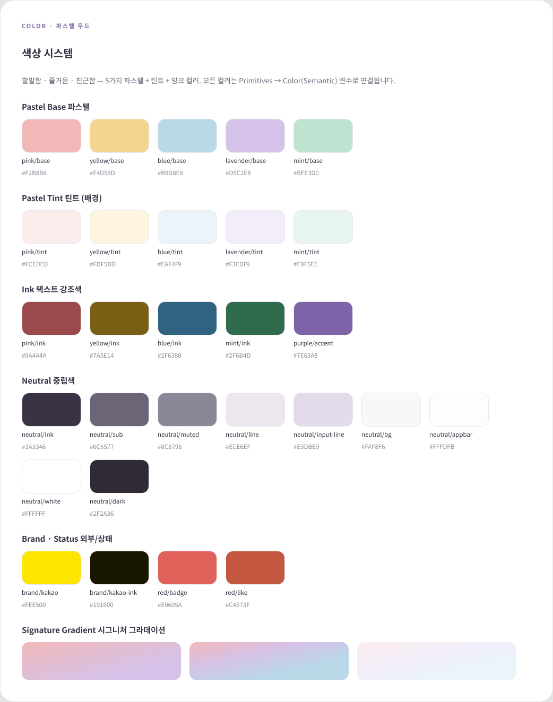
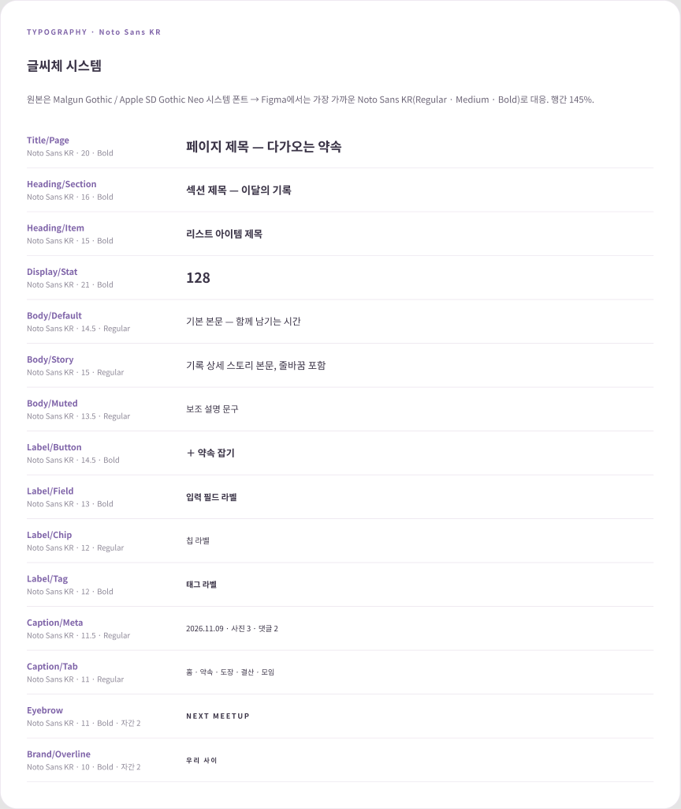
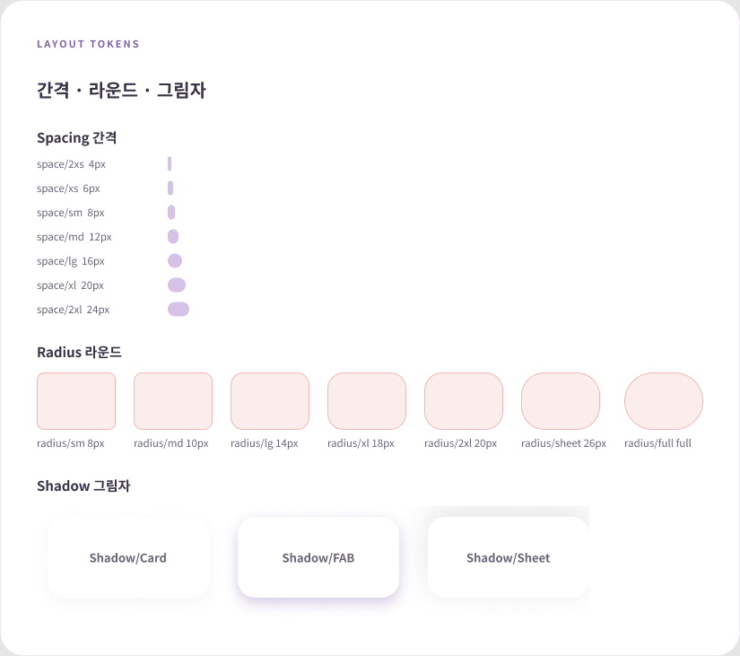
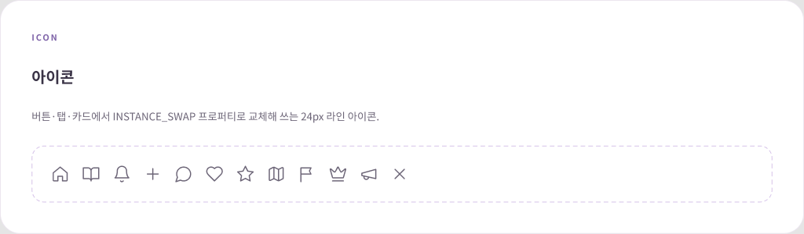
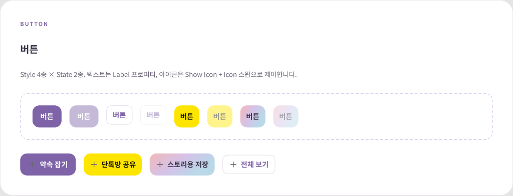
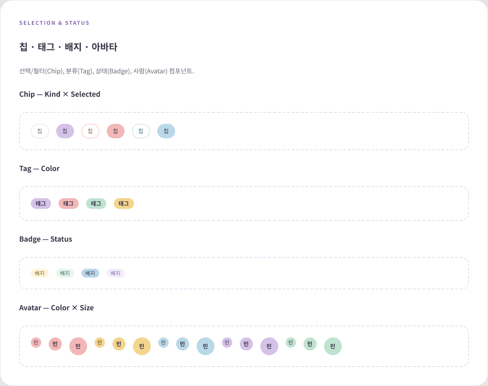
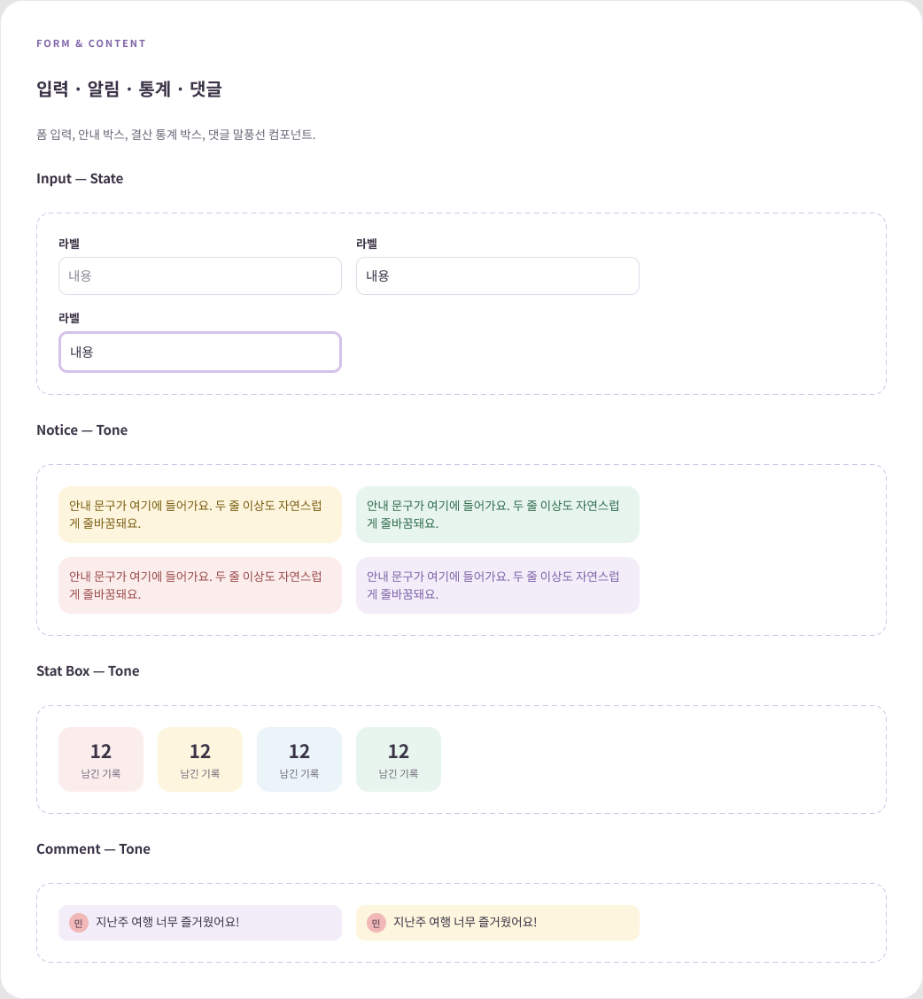
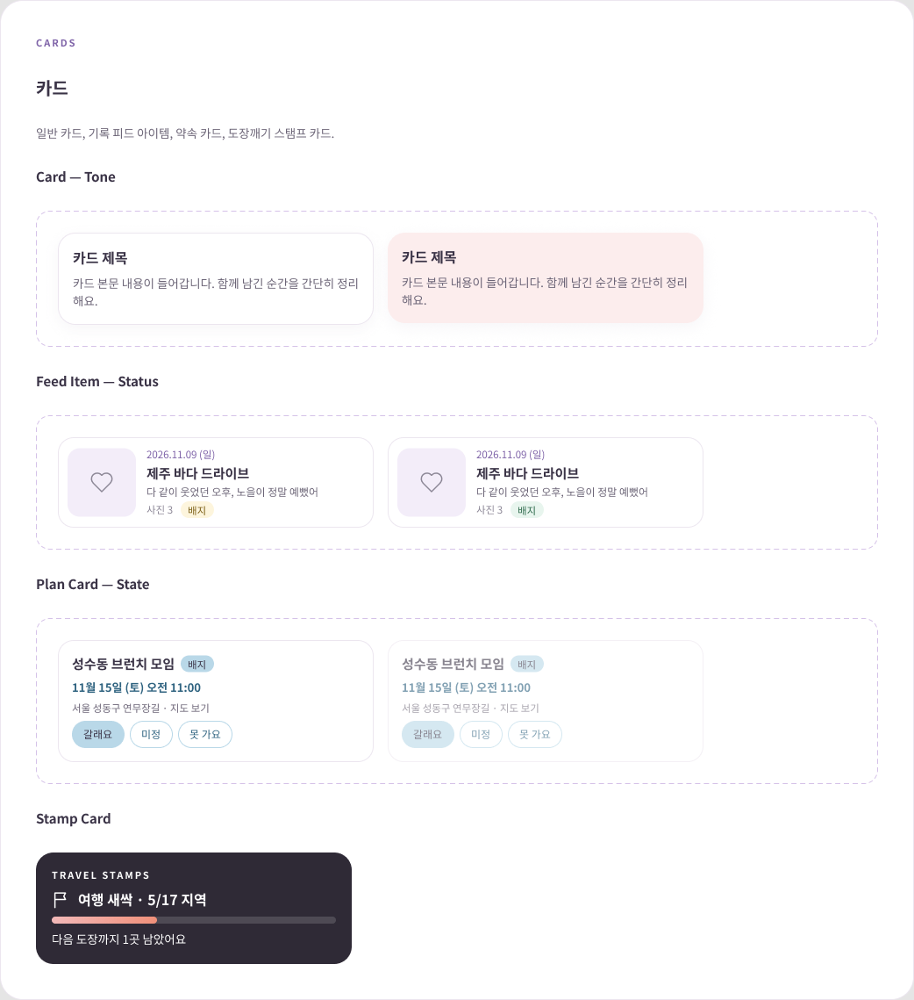
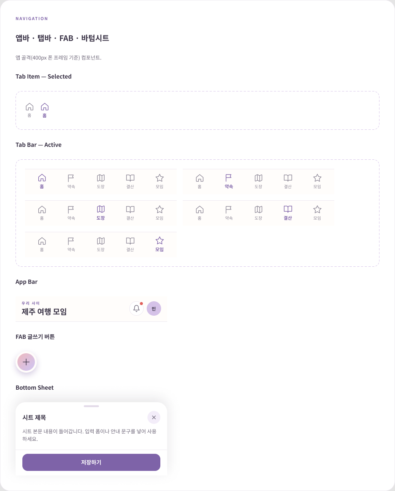

# 우리사이 디자인 시스템 (v.5)

여행·약속·기록을 함께 남기는 모임 앱 **우리사이**의 HTML 프로토타입(v.5)을 분석해,
Figma에 토큰 → 스타일 → 컴포넌트 순서로 정리한 디자인 시스템입니다.

- **한 줄 요약**: 파스텔 5색 + 라벤더 포인트(#7E63A8)로 "따뜻하고 가벼운 모임 앱" 톤을 변수·스타일·컴포넌트 19개로 구조화
- **작업 범위**: 디자인 토큰 설계, 컴포넌트 설계(프로퍼티·변형), 네이밍·규칙 정립
- **도구**: Figma(Variables · Text/Effect Styles · Component Properties), HTML/CSS 분석
- **Figma 파일**: Body Log · Card News (UXSSG 프로젝트)

## 디자인 원칙

1. **Rectangle 금지** – 모든 요소를 오토레이아웃 프레임으로 구성 (원형도 라운드 프레임)
2. **컴포넌트 프로퍼티** – 문구는 TEXT, 아이콘은 INSTANCE_SWAP, 표시 여부는 BOOLEAN, 스타일·상태는 VARIANT
3. **텍스트는 콘텐츠** – 모든 텍스트에 텍스트 스타일 적용(297개), 문구는 프로퍼티로 교체
4. **프레임 이름 규칙** – 기본 이름(Frame 1 등) 0개
5. **토큰 3단 구조** – Primitives → Color(semantic alias) → 컴포넌트에 바인딩. 모든 변수에 `var(--…)` 코드 문법 부여

## 토큰

| 컬렉션 | 개수 | 내용 |
|---|---|---|
| Primitives | 28 | 핑크·옐로·블루·라벤더·민트(base/tint/ink), 중립색, 카카오, 뱃지색 |
| Color | 38 | bg / text / border / icon 용도별 alias |
| Spacing | 7 | 4 · 6 · 8 · 12 · 16 · 20 · 24 |
| Radius | 7 | 8 · 10 · 14 · 18 · 20 · 26 · full |

→ [tokens/tokens.css](tokens/tokens.css) (코드용), [tokens/typography.md](tokens/typography.md) (글씨체·그림자)

## 컴포넌트 19개

| 영역 | 컴포넌트 | 주요 프로퍼티 |
|---|---|---|
| 기본 | Icon(12종) | Name |
| | Button | Style×State, Label, Show Icon, Icon |
| | Chip · Tag · Badge · Avatar | 톤/상태 변형, 라벨 |
| 입력·콘텐츠 | Input · Notice · Stat Box · Comment | 상태 변형, 라벨/본문 TEXT |
| 카드 | Card · Feed Item · Plan Card · Stamp Card | Tone/Status/State, 제목·본문 TEXT |
| 내비게이션 | Tab Item · Tab Bar · App Bar · FAB · Bottom Sheet | Active, 제목 TEXT |

## 화면 미리보기

| | |
|---|---|
|  |  |
|  |  |
|  |  |
|  |  |
|  | |

## 한계와 다음 단계

- 원본의 Malgun Gothic은 Figma에 없어 Noto Sans KR로 대응했습니다.
- 아이콘을 스왑하면 색이 기본색으로 돌아갑니다(어두운 배경 버튼은 별도 지정 필요).
- 라이브러리 게시와 Code Connect는 아직 하지 않았습니다.
- 다음: 컴포넌트를 실제 화면에 적용하고, 적용 전후 비교를 포트폴리오에 추가

## 폴더

```
우리사이_디자인시스템/
├─ README.md
├─ tokens/      tokens.css · typography.md
├─ screenshots/ 섹션별 캡처 9장
└─ source/      원본 HTML 프로토타입(v.5)
```
